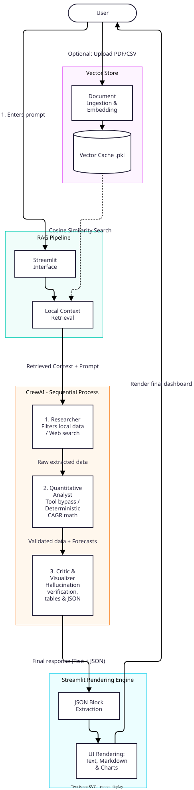

# AIconomy

**AIconomy** can be considered a Proof of Concept (PoC) demonstrating a deterministic, multi-agent macroeconomic analysis system. Built with **CrewAI**, **Streamlit**, and the **Gemini API**, this application orchestrates autonomous AI agents to research, calculate, and visualize economic data while actively preventing LLM mathematical hallucinations. Basically, it's main objective is to process different complex economic scenarios

## Key Features | Architecture

*   **Multi-Agent Orchestration (CrewAI) |** The system divides complex queries into sequential tasks handled by three specialized agents:
    *   **Web Researcher |** Fetches real-time data via DuckDuckGo or parses local documents (RAG) using strict source priority rules. Strictly forbidden from doing math.
    *   **Quantitative Analyst |** A dedicated agent that triggers deterministic Python tools to process raw numbers.
    *   **Macroeconomic Critic |** Formats outputs into Markdown tables and extracts chronological data into JSON structures for dynamic UI charting.
*   **Neuro-Symbolic Approach |** To guarantee mathematical accuracy, the LLM is restricted from performing internal calculations. All trend estimates (CAGR) and rate variations are securely routed through a custom `Economic Forecast Tool` and a sandboxed `Calculator Tool`.
*   **Local RAG & Caching |** Integrates local economic documents as priority context and utilizes vector caching to minimize API latency and redundant token costs.
*   **Interactive UI |** A Streamlit frontend that manages conversation state, visualizes JSON chart blocks generated by the Critic agent, and handles user interactions.

### This app's overview is provided below: 


## Technology Stack

*   **Language:** Python 3.10+
*   **AI/LLM Frameworks:** CrewAI, Google Gemini API (gemini-3.8-flash)
*   **Search & Data:** DuckDuckGo Search (DDGS)
*   **Frontend:** Streamlit
*   **Deployment:** Docker

## Running the app - guide

### Option 1 | Using Docker (Recommended)

1. Clone the repository:
   ```bash
   git clone [https://github.com/your-username/aiconomy.git](https://github.com/your-username/aiconomy.git)
   cd aiconomy

   ```

2. Create a .env file in the root directory and add your API key:

    ```bash
    GEMINI_API_KEY="your_api_key_here"
    ```
    (Or, you can paste your API Key (Gemini) in the .streamlit/secrets.toml file by removing the string example.
   
3. Build and run the Docker container:

    ```bash
    docker build -t aiconomy-app .
    docker run -p 8501:8501 aiconomy-app
    ```
    
    To persist conversation history or cache locally, run with a mounted volume in the following way:
   ```bash
   docker run -p 8501:8501 -v "%cd%:/app" aiconomy-app
   ```
   

  4. Open `http://localhost:8501` in your browser.

### Option 2 | Local Python environment/ setup
  1. Clone the repository and navigate to the folder.

  2. Create and activate a virtual environment, in the following way:
```bash
python -m venv venv
source venv/bin/activate
```
##### [WARNING] On Windows, you need to use: 
```cmd
venv\Scripts\activate
```

  3. Install the required dependencies for running the application:

```bash
pip install -r requirements.txt
```

  4. Set up your Streamlit secrets/ api key(s) - you may take a look at the template provided in the .streamlit folder.

##### [IMPORTANT] Add your GEMINI_API_KEY inside secrets.toml

  5. In order to run the Streamlit application, use:

```bash
streamlit run AIconomy_UI.py
```


